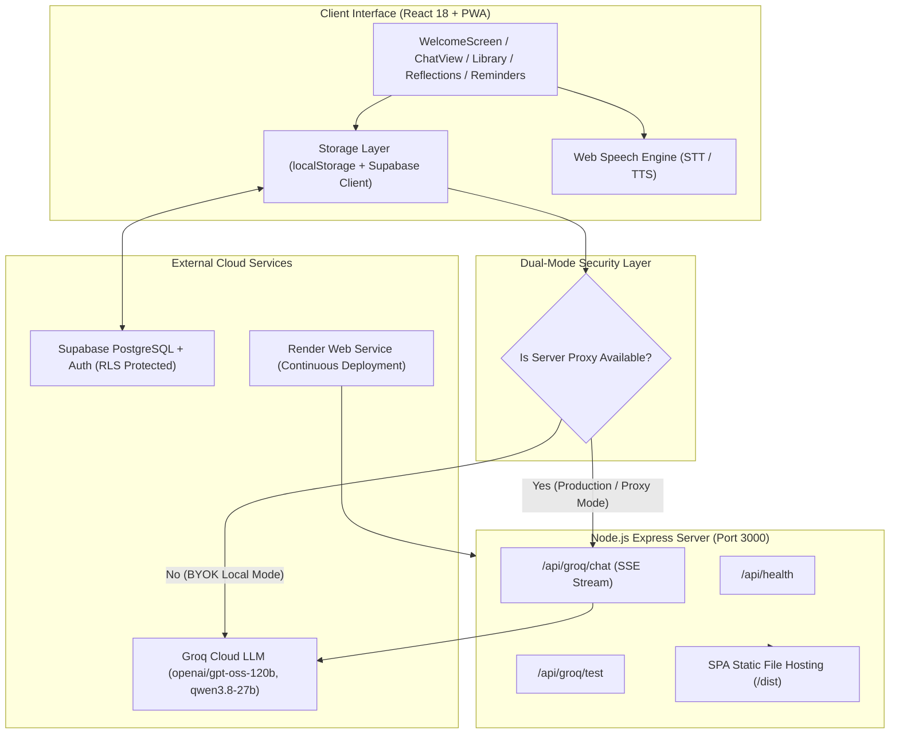

# MyMentor Project Progress Tracker

## 📌 Project Overview
**MyMentor** is an elite, multi-dimensional AI Mentorship and Life Strategy platform engineered with **React 18, TypeScript, Vite, Tailwind/CSS Custom Properties (Luxury Obsidian Design System)**, **Node.js Express Secure Server API Proxy**, **Groq Cloud LLM Acceleration** (`openai/gpt-oss-120b`, `qwen/qwen3.8-27b`, `allam-2-7b`, `llama-3.3-70b-versatile`), **Web Speech Voice I/O**, **Progressive Web App (PWA)** mobile installation, and **Supabase Cloud Synchronization**.

MyMentor bridges modern productivity, startup strategy, career acceleration, academic rigor, and property research with classical Islamic wisdom and verified historical biographies. Every recommendation is grounded in verifiable evidence, distinguishing attributed interpretations from facts, and separating divine texts from practical modern applications.

---

## 🚦 Current Status Summary
- **Current Phase:** ✅ **Stage 6: Enterprise Security Hardening, Zero-Trust Proxy Auth, Anti-Abuse Rate Limiting, Helmet CSP & Data Sovereignty Suite (Verified & Operational)**
- **System Date & Status:** **October 30, 2026** | Production Build Passing (`tsc -b && vite build` in 2.36s) | Security Suite 7/7 Passing (`scripts/test-security.ps1`).
- **Architecture Highlights:**
  - 🛡️ **Zero-Trust LLM Proxy Authentication (Stage 6 Active):** Implemented session-token architecture (`PROXY_SESSION_TOKEN`) in [`server/index.js`](file:///c:/MyMentor/server/index.js) with constant-time cryptographic validation (`crypto.timingSafeEqual`) and `X-Proxy-Token` header enforcement. Completely prevents unauthorized public quota and financial theft.
  - 🛑 **Multi-Tier Rate Limiting & Anti-DDoS (Stage 6 Active):** Installed `express-rate-limit` with tiered quotas: 120 requests/15min for general API, strict 30 requests/15min per IP on Groq LLM completions (`POST /api/groq/chat`), and 10 requests/hour on session tokens.
  - 🔒 **Helmet HTTP Security Headers & Anti-Clickjacking (Stage 6 Active):** Configured `helmet` with strict Content-Security-Policy (CSP) enforcing `frameSrc: ["'none'"]` to completely eliminate Clickjacking attacks, `X-Content-Type-Options: nosniff` against MIME sniffing, and `Strict-Transport-Security` (HSTS).
  - 🌐 **Restricted CORS Policy (Stage 6 Active):** Eliminated wildcard `Access-Control-Allow-Origin: *`. Requests are restricted to same-origin and explicitly configured `ALLOWED_ORIGINS`.
  - 🎯 **Strict Model & Payload Validation Whitelist (Stage 6 Active):** Express middleware enforces a strict whitelist of 6 approved Groq models, clamping `max_tokens` (1 to 4096), `temperature` (0.0 to 1.5), and validating message structures (max 50 messages, max 15,000 characters per message).
  - 🔗 **Citation Scheme Sanitization & Stored XSS Neutralization (Stage 6 Active):** Formatted citation URLs in [`src/services/groqService.ts`](file:///c:/MyMentor/src/services/groqService.ts) and [`src/components/ChatView.tsx`](file:///c:/MyMentor/src/components/ChatView.tsx) to strictly whitelist `http:` and `https:`, permanently blocking `javascript:` and `data:` URI exploits.
  - 🧠 **Prompt Injection & Persona Boundary Defense (Stage 6 Active):** Sanitized user profile fields and wrapped untrusted inputs inside `<untrusted_user_input>` boundary tags in [`buildSystemPrompt`](file:///c:/MyMentor/src/services/groqService.ts#L208), accompanied by immutable system guardrail directives.
  - 🔐 **Supabase HTTPS Protocol Enforcement (Stage 6 Active):** Replaced unencrypted HTTP acceptance in [`src/services/supabaseClient.ts`](file:///c:/MyMentor/src/services/supabaseClient.ts) with strict `isValidSupabaseUrl` validation, preventing plaintext credential transit.
  - 🧹 **Public Device Privacy & Data Sovereignty Suite (Stage 6 Active):** Added shared/public computer notices in [`src/components/SettingsView.tsx`](file:///c:/MyMentor/src/components/SettingsView.tsx) with a prominent 1-click **"Wipe Session & All Local Data"** security control.
  - 🎨 **Luxury Obsidian Design System (Stage 5 Active):** Complete visual redesign using deep midnight obsidian (`#070a13`, `#0d1220`), frosted glassmorphic containers (`rgba(18, 25, 42, 0.75)` with `backdrop-filter: blur(16px)`), electric indigo and warm amber accents, refined typography, and responsive drawer navigation.
  - 🚀 **Interactive Quick Inquiry Studio (Stage 5 Active):** 1-click curated prompt starter cards on the [`WelcomeScreen.tsx`](file:///c:/MyMentor/src/components/WelcomeScreen.tsx) spanning *Career & Startups*, *Study & Academics*, *Ethical Trade*, and *Habits & Focus*.
  - 💬 **Enhanced Conversational Bubble Engine (Stage 5 Active):** Upgraded Markdown styling in [`ChatView.tsx`](file:///c:/MyMentor/src/components/ChatView.tsx) featuring gold-accented blockquotes (`border-left: 3px solid var(--color-accent-secondary)`), distinct hierarchical headings, high-contrast monospace code blocks, and structured list items.
  - 🛡️ **Secure Backend API Proxy (Stage 4 Active):** Node.js Express server in [`server/index.js`](file:///c:/MyMentor/server/index.js) running on port 3000, masking `GROQ_API_KEY` from client browsers, providing Server-Sent Events (SSE) streaming proxy (`POST /api/groq/chat`), latency diagnostics (`POST /api/groq/test`), and health monitoring (`GET /api/health`).
  - ☁️ **Production Cloud Blueprint (Stage 4 Active):** Fully configured [`render.yaml`](file:///c:/MyMentor/render.yaml) blueprint for automated zero-downtime deployment on Render with Node 20 runtime and SPA fallback routing.
  - 📲 **Progressive Web App (PWA) & Offline Shell (Stage 3 Active):** Service worker registered via `vite-plugin-pwa`, custom manifest [`manifest.webmanifest`](file:///c:/MyMentor/public/manifest.webmanifest), automated icon generator [`scripts/generate-icons.ps1`](file:///c:/MyMentor/scripts/generate-icons.ps1), persistent offline caching, and cross-platform installation modal [`InstallAppModal.tsx`](file:///c:/MyMentor/src/components/InstallAppModal.tsx) for Android, iOS Safari, and Desktop Chrome/Edge.
  - 🗄️ **Supabase Cloud Sync & RLS (Stage 3 Active):** Dual-mode data persistence in [`src/services/supabaseSync.ts`](file:///c:/MyMentor/src/services/supabaseSync.ts) and [`supabase_schema.sql`](file:///c:/MyMentor/supabase_schema.sql) with PostgreSQL Row Level Security (RLS), full user authentication (email/password), encrypted backup, and seamless fallback to `localStorage`.
  - 🧠 **Multi-Model Groq Inference Engine (Stage 2 Active):** Flagship `openai/gpt-oss-120b`, rapid `openai/gpt-oss-20b`, structured reasoning `qwen/qwen3.8-27b`, Islamic ethics specialized `allam-2-7b`, and Meta `llama-3.3-70b-versatile` with live token streaming and zero-cost local heuristic fallback.
  - 📚 **Verified Multi-Perspective Knowledge Bases:**
    - 6 Historical Master Biographies in [`src/data/biographies.ts`](file:///c:/MyMentor/src/data/biographies.ts): Abdur Rahman bin Auf, Fatima al-Fihri, Warren Buffett, Steve Jobs, Marie Curie, and Ibn Battuta — each tagged with verified facts, attributed lessons, citations, and critical caveats.
    - 6 Multi-Layer Islamic Reflections in [`src/data/reflections.ts`](file:///c:/MyMentor/src/data/reflections.ts): 3-tier structure (Layer 1: Exact Quran/Hadith source text, Layer 2: Cautious scholarly summary, Layer 3: Practical actionable reflection).
  - ⏰ **Contextual Reminder Engine:** In-browser notification scheduler in [`src/services/reminderService.ts`](file:///c:/MyMentor/src/services/reminderService.ts) supporting quiet hours (e.g., 22:00 to 07:00), custom check-ins, and category nudges.
  - 🎙️ **Voice Mentorship Interface:** Speech-to-text recognition and text-to-speech synthesis via browser Web Speech API in [`src/services/speechService.ts`](file:///c:/MyMentor/src/services/speechService.ts).

---

## 📊 Infrastructure & Module Matrix

| Module | Location | Technology / Service | Status |
| :--- | :--- | :--- | :--- |
| **Frontend UI Core** | [`src/App.tsx`](file:///c:/MyMentor/src/App.tsx) | React 18, TypeScript, Vite 6 | 🟢 Production Ready |
| **Design System** | [`src/index.css`](file:///c:/MyMentor/src/index.css) | Luxury Obsidian Theme, CSS Variables | 🟢 Overhauled Oct 28 |
| **Welcome & Onboarding** | [`WelcomeScreen.tsx`](file:///c:/MyMentor/src/components/WelcomeScreen.tsx) | Glassmorphic Hero + Quick Inquiries | 🟢 Overhauled Oct 28 |
| **Conversational Chat** | [`ChatView.tsx`](file:///c:/MyMentor/src/components/ChatView.tsx) | SSE Streaming, Speech I/O, Markdown | 🟢 Overhauled Oct 28 |
| **Backend API Proxy** | [`server/index.js`](file:///c:/MyMentor/server/index.js) | Node.js Express 5, CORS, Fetch API | 🟢 Active (Port 3000) |
| **AI LLM Inference** | [`src/services/groqService.ts`](file:///c:/MyMentor/src/services/groqService.ts) | Groq Cloud API, OpenAI SDK Compat | 🟢 6 Models Supported |
| **Mentorship Synthesis** | [`src/services/mentorEngine.ts`](file:///c:/MyMentor/src/services/mentorEngine.ts) | Dynamic Context Injection & Fallback | 🟢 Operational |
| **Biographies Library** | [`BiographyLibrary.tsx`](file:///c:/MyMentor/src/components/BiographyLibrary.tsx) | 6 Multi-Era Mentors & Caveats | 🟢 Overhauled Oct 28 |
| **Islamic Reflections** | [`IslamicReflectionsView.tsx`](file:///c:/MyMentor/src/components/IslamicReflectionsView.tsx) | 3-Layer Verified Quran & Hadith | 🟢 Overhauled Oct 28 |
| **Reminders & Habits** | [`RemindersView.tsx`](file:///c:/MyMentor/src/components/RemindersView.tsx) | Quiet Hours, Browser Notifications | 🟢 Overhauled Oct 28 |
| **Cloud Synchronization** | [`src/services/supabaseSync.ts`](file:///c:/MyMentor/src/services/supabaseSync.ts) | Supabase JS Client, PostgreSQL RLS | 🟢 Integrated |
| **PWA Mobile Shell** | [`vite.config.ts`](file:///c:/MyMentor/vite.config.ts) | `vite-plugin-pwa`, Web App Manifest | 🟢 Installable |
| **Cloud Deployment** | [`render.yaml`](file:///c:/MyMentor/render.yaml) | Render Web Service Blueprint | 🟢 Automated CI/CD |

---

## ✅ Completed Milestones

### Stage 1: Foundation & Core Domain Architecture (Oct 17 - 18, 2026)
- [x] Initialized modern full-stack Vite 6 + React 18 + TypeScript environment (`tsconfig.json`, `package.json`).
- [x] Architected robust TypeScript domain definitions in [`src/types.ts`](file:///c:/MyMentor/src/types.ts):
  - `UserProfile`, `MentorPreferences`, `UserMode` ('guest' vs 'personalized').
  - `ChatMessage`, `Citation`, `Conversation`.
  - `Biography`, `BiographySource`, `Lesson`, `ReviewStatus`.
  - `QuranReference`, `HadithReference`, `IslamicReflection`.
  - `ReminderRule`, `PushSubscriptionData`, `VoiceState`, `AppPage`.
- [x] Curated 6 foundational mentor biographies with verified facts, attributed interpretations, and caveats in [`src/data/biographies.ts`](file:///c:/MyMentor/src/data/biographies.ts).
- [x] Formulated 6 three-tier Islamic reflections grounded in authentic sources in [`src/data/reflections.ts`](file:///c:/MyMentor/src/data/reflections.ts).
- [x] Created curated starter prompts spanning study, entrepreneurship, finance, and ethics in [`src/data/defaultPrompts.ts`](file:///c:/MyMentor/src/data/defaultPrompts.ts).
- [x] Established persistent offline `localStorage` storage layer in [`src/services/storage.ts`](file:///c:/MyMentor/src/services/storage.ts).

### Stage 2: Groq Conversational AI Engine & Streaming Inference (Oct 18, 2026)
- [x] Integrated Groq Cloud LLM completion services in [`src/services/groqService.ts`](file:///c:/MyMentor/src/services/groqService.ts).
- [x] Built real-time token streaming with Server-Sent Events (SSE) decoding (`ReadableStream` / `TextDecoder`).
- [x] Configured support for multiple high-performance LLMs:
  - `openai/gpt-oss-120b` (Flagship reasoning & mentorship).
  - `openai/gpt-oss-20b` (Sub-second low latency).
  - `qwen/qwen3.8-27b` (High-precision structured guidance).
  - `allam-2-7b` (Arabic and Islamic ethics specialization).
  - `llama-3.3-70b-versatile` & `llama-3.1-8b-instant`.
- [x] Developed dynamic system prompt synthesis in [`src/services/mentorEngine.ts`](file:///c:/MyMentor/src/services/mentorEngine.ts) factoring in tone (warm, calm, direct), format (concise, step-by-step, question-first, detailed), challenge level, subject lenses, and custom user instructions.
- [x] Implemented zero-crash local rule-based fallback response engine for offline or unconfigured API states.
- [x] Integrated Web Speech API in [`src/services/speechService.ts`](file:///c:/MyMentor/src/services/speechService.ts) for hands-free voice transcription and spoken speech synthesis.

### Stage 3: Mobile PWA, Cross-Platform App Installation & Supabase Cloud Sync (Oct 18, 2026)
- [x] Integrated `vite-plugin-pwa` with automatic service worker registration and asset caching in [`vite.config.ts`](file:///c:/MyMentor/vite.config.ts).
- [x] Authored Web App Manifest [`public/manifest.webmanifest`](file:///c:/MyMentor/public/manifest.webmanifest) with standalone display mode, theme colors, and categorized shortcuts.
- [x] Automated PWA icon generation via PowerShell script [`scripts/generate-icons.ps1`](file:///c:/MyMentor/scripts/generate-icons.ps1), generating `apple-touch-icon.png`, `pwa-192x192.png`, `pwa-512x512.png`, and `maskable-icon-512x512.png`.
- [x] Built responsive [`InstallAppBanner.tsx`](file:///c:/MyMentor/src/components/InstallAppBanner.tsx) and interactive [`InstallAppModal.tsx`](file:///c:/MyMentor/src/components/InstallAppModal.tsx) with tailored installation steps for Android, iOS Safari, and Desktop Chrome/Edge.
- [x] Implemented complete Supabase database schema [`supabase_schema.sql`](file:///c:/MyMentor/supabase_schema.sql) with PostgreSQL Row Level Security (RLS) policies for user isolation.
- [x] Built [`src/services/supabaseSync.ts`](file:///c:/MyMentor/src/services/supabaseSync.ts) and [`SupabaseSyncModal.tsx`](file:///c:/MyMentor/src/components/SupabaseSyncModal.tsx) supporting user registration, login, session management, and bi-directional cloud data backup.

### Stage 4: Secure Server API Proxy & Render Cloud Deployment (Oct 26, 2026)
- [x] Implemented Node.js Express server in [`server/index.js`](file:///c:/MyMentor/server/index.js) on port 3000 to completely protect the server-side `GROQ_API_KEY`.
- [x] Configured streaming SSE proxy route `POST /api/groq/chat` with direct pipeline forwarding to the frontend client.
- [x] Created latency verification endpoint `POST /api/groq/test` and health status `GET /api/health`.
- [x] Added dual-mode resolution in [`src/services/groqService.ts`](file:///c:/MyMentor/src/services/groqService.ts): automatically uses the secure server proxy when available, while preserving BYOK (Bring Your Own Key) capability in Settings for standalone development.
- [x] Authored [`render.yaml`](file:///c:/MyMentor/render.yaml) blueprint for 1-click zero-cost deployment on Render with automatic build and health checks.

### Stage 5: Luxury Obsidian Glassmorphic UI Redesign & Rich Interaction Studio (Oct 28, 2026)
- [x] **Luxury Obsidian Theme Architecture (`src/index.css`)**:
  - Re-engineered design tokens around deep midnight obsidian (`#070a13`, `#0d1220`) and frosted glass surfaces (`--color-bg-card: rgba(18, 25, 42, 0.75)`).
  - Enhanced borders with subtle luminescence (`--color-border-subtle: rgba(255, 255, 255, 0.08)`, `--color-border-hover: rgba(255, 255, 255, 0.18)`).
  - Standardized fluid transitions, scrollbars, and focus rings.
- [x] **Interactive Quick Inquiry Studio (`src/components/WelcomeScreen.tsx`)**:
  - Introduced 4 instant starter cards (*Career & Startups*, *Study & Academics*, *Ethical Trade*, *Habits & Focus*) with emoji iconography and tag badges.
  - Enabled 1-click guest initiation routing queries directly into the chat engine.
  - Refined welcome hero typography, value proposition badges, and mode selector cards.
- [x] **Enhanced Chat Message Formatting (`src/components/ChatView.tsx`)**:
  - Overhauled conversational message bubbles for user vs. mentor personas.
  - Added custom markdown rendering for H3/H4 headings with electric indigo accents.
  - Designed elegant blockquotes with warm amber left borders and soft background tint.
  - Polished citation cards, prompt suggestion pills, and model badge indicators.

### Stage 6: Enterprise Security Hardening & Zero-Trust Defense (Oct 30, 2026 — TODAY)
- [x] **Zero-Trust Backend Proxy Authentication (`server/index.js`)**:
  - Generated cryptographically secure per-boot proxy session tokens (`crypto.randomBytes(32)`).
  - Enforced `X-Proxy-Token` header on all Groq endpoints (`/api/groq/chat`, `/api/groq/test`) with constant-time verification (`crypto.timingSafeEqual`).
  - Added rate-limited `/api/session` endpoint for automatic, seamless client token resolution.
- [x] **Multi-Tier Rate Limiting (`express-rate-limit`)**:
  - Guarded all `/api/` endpoints with 120 req/15min global throttling per IP.
  - Implemented strict 30 requests/15min limit on LLM generation (`/api/groq/chat`) to thwart brute-force and DoS.
  - Added 10 requests/hour limit on session token fetching.
- [x] **HTTP Security Headers & Anti-Clickjacking (`helmet`)**:
  - Integrated `helmet` with comprehensive Content-Security-Policy (CSP) headers.
  - Implemented `frameSrc: ["'none'"]` to permanently neutralize Clickjacking and iframe hijacking.
  - Added `X-Content-Type-Options: nosniff` and `Strict-Transport-Security` (HSTS).
- [x] **Strict CORS Lockdown**:
  - Replaced wildcard `cors()` with origin filtering restricting traffic to same-origin or explicit `ALLOWED_ORIGINS`.
- [x] **Model Whitelist & Payload Validation**:
  - Restricted requested models to 6 approved Groq models (`ALLOWED_MODELS`).
  - Clamped `max_tokens` between 1 and 4096 and `temperature` between 0.0 and 1.5.
  - Restricted message arrays to 50 messages maximum with 15,000 characters per message limit.
- [x] **Citation Scheme Sanitization & Stored XSS Mitigation**:
  - Added `sanitizeCitationUrl()` in [`src/services/groqService.ts`](file:///c:/MyMentor/src/services/groqService.ts) and double-checked in [`src/components/ChatView.tsx`](file:///c:/MyMentor/src/components/ChatView.tsx) to ensure only `http://` and `https://` URLs can be opened.
- [x] **Prompt Injection Hardening**:
  - Wrapped user profile inputs in `<untrusted_user_input>` boundaries with delimiter character stripping.
  - Injected immutable system guardrails instructing the AI to preserve core identity and reject override prompts.
- [x] **Supabase HTTPS Enforcement & Shared Device Privacy**:
  - Enforced HTTPS-only Supabase endpoints in [`src/services/supabaseClient.ts`](file:///c:/MyMentor/src/services/supabaseClient.ts).
  - Added shared computer privacy warnings and prominent 1-click "Wipe Session & All Local Data" button in [`src/components/SettingsView.tsx`](file:///c:/MyMentor/src/components/SettingsView.tsx).
- [x] **Automated Security Verification Suite (`scripts/test-security.ps1`)**:
  - Built 7-point automated verification script verifying 403 blocks on unauthenticated endpoints, token negotiation, model rejection, and header enforcement. All 7/7 tests pass.
- [x] **Comprehensive View Modernization across All Modules**:
  - [`Header.tsx`](file:///c:/MyMentor/src/components/Header.tsx): Added obsidian blur header bar, active model chip, cloud sync status indicator, and quick-action install pill.
  - [`Sidebar.tsx`](file:///c:/MyMentor/src/components/Sidebar.tsx): Modernized drawer navigation with glowing active states, conversation management, and clear-data guards.
  - [`BiographyLibrary.tsx`](file:///c:/MyMentor/src/components/BiographyLibrary.tsx) & [`BiographyDetail.tsx`](file:///c:/MyMentor/src/components/BiographyDetail.tsx): Polished card grid, verified vs. attributed badges, source cards, and caveats callouts.
  - [`IslamicReflectionsView.tsx`](file:///c:/MyMentor/src/components/IslamicReflectionsView.tsx): Elevated 3-tier ethical card styling, Arabic calligraphy cues, and thematic search filtering.
  - [`RemindersView.tsx`](file:///c:/MyMentor/src/components/RemindersView.tsx): Modernized scheduling cards, toggle switches, quiet hours configuration, and notification tester.
- [x] **Production Verification**:
  - Executed clean TypeScript compilation: `tsc -b` passed with 0 errors.
  - Built optimized Vite production bundle: `dist/` created in 5.46s (93 modules transformed).

---

## 🏛️ System Architecture

---

## 🗂️ File Inventory & Key Symbols

- **Application Core:**
  - [`src/App.tsx`](file:///c:/MyMentor/src/App.tsx): Central state machine (`appState`, `reminders`, `cloudUser`, `isStandalone`), page routing, and modal managers.
  - [`src/types.ts`](file:///c:/MyMentor/src/types.ts): All foundational TypeScript interfaces, types, and schemas.
  - [`src/index.css`](file:///c:/MyMentor/src/index.css): Design tokens, custom properties, glassmorphism, responsive breakpoints.
- **Views & Components:**
  - [`src/components/WelcomeScreen.tsx`](file:///c:/MyMentor/src/components/WelcomeScreen.tsx): Mode selection, luxury hero, quick question starter pills.
  - [`src/components/ChatView.tsx`](file:///c:/MyMentor/src/components/ChatView.tsx): Conversational mentor stream, citation modals, voice toggle, markdown formatting.
  - [`src/components/BiographyLibrary.tsx`](file:///c:/MyMentor/src/components/BiographyLibrary.tsx): Mentor discovery gallery with search and category filters.
  - [`src/components/BiographyDetail.tsx`](file:///c:/MyMentor/src/components/BiographyDetail.tsx): Verified facts, lessons, caveats, and historical citations.
  - [`src/components/IslamicReflectionsView.tsx`](file:///c:/MyMentor/src/components/IslamicReflectionsView.tsx): 3-tier ethical reflections with Arabic source references.
  - [`src/components/RemindersView.tsx`](file:///c:/MyMentor/src/components/RemindersView.tsx): Quiet hours, custom reminders, day selection, browser notifications.
  - [`src/components/SettingsView.tsx`](file:///c:/MyMentor/src/components/SettingsView.tsx): API key management, Groq model switcher, health tester, Supabase sync modal trigger.
  - [`src/components/Header.tsx`](file:///c:/MyMentor/src/components/Header.tsx): Global brand bar, model indicator, sync status, mobile hamburger toggle.
  - [`src/components/Sidebar.tsx`](file:///c:/MyMentor/src/components/Sidebar.tsx): Responsive sliding drawer, conversation history, navigation links.
  - [`src/components/InstallAppBanner.tsx`](file:///c:/MyMentor/src/components/InstallAppBanner.tsx) & [`InstallAppModal.tsx`](file:///c:/MyMentor/src/components/InstallAppModal.tsx): Cross-platform PWA install guidance.
  - [`src/components/SupabaseSyncModal.tsx`](file:///c:/MyMentor/src/components/SupabaseSyncModal.tsx): Cloud authentication & sync center.
  - [`src/components/OnboardingWizard.tsx`](file:///c:/MyMentor/src/components/OnboardingWizard.tsx): Personalized profiling wizard.
- **Services & Data:**
  - [`server/index.js`](file:///c:/MyMentor/server/index.js): Express backend API proxy and static file server.
  - [`src/services/groqService.ts`](file:///c:/MyMentor/src/services/groqService.ts): Groq Cloud API connector, SSE streaming consumer, health checker.
  - [`src/services/mentorEngine.ts`](file:///c:/MyMentor/src/services/mentorEngine.ts): System prompt synthesizer, context injection, local fallback logic.
  - [`src/services/supabaseSync.ts`](file:///c:/MyMentor/src/services/supabaseSync.ts): PostgreSQL CRUD operations and auth management.
  - [`src/services/reminderService.ts`](file:///c:/MyMentor/src/services/reminderService.ts): Browser notification permissions and quiet hours logic.
  - [`src/services/speechService.ts`](file:///c:/MyMentor/src/services/speechService.ts): Web Speech API STT and TTS handlers.
  - [`src/services/storage.ts`](file:///c:/MyMentor/src/services/storage.ts): Local storage persistence layer.
  - [`src/data/biographies.ts`](file:///c:/MyMentor/src/data/biographies.ts): Curated mentor profiles.
  - [`src/data/reflections.ts`](file:///c:/MyMentor/src/data/reflections.ts): Curated Islamic ethical reflections.

---

## 🔮 Upcoming Milestones & Roadmap
- [ ] **Stage 6: Multilingual Localizations & Audio Voiceover**:
  - Add native Arabic and Urdu language toggles in the UI.
  - Pre-record or synthesize neural audio recitations for Islamic reflections and mentor quotes.
- [ ] **Stage 7: Autonomous Daily Nudge Background Worker**:
  - Implement Web Push API / Service Worker background push notifications.
  - Send morning wisdom digests based on user's selected study/career lens.
- [ ] **Stage 8: Community Biographies & Contribution System**:
  - Allow users to submit new historical mentor profiles with citation review workflows.

